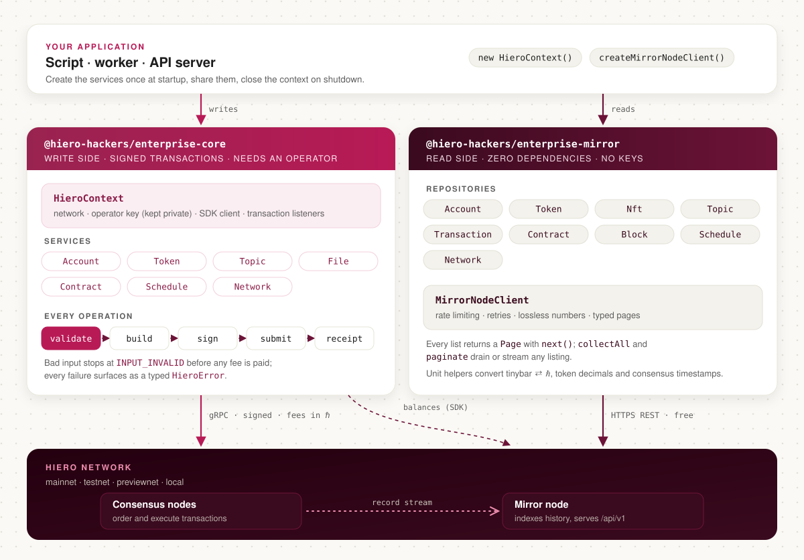

# Hiero Enterprise JS

TypeScript libraries for building Node.js services on [Hiero](https://hiero.org) networks: send transactions with `@hiero-hackers/enterprise-core`, and read the network's history with `@hiero-hackers/enterprise-mirror`.

[](../../actions/workflows/build.yml)
[](../../actions/workflows/build.yml)
[](https://scorecard.dev/viewer/?uri=github.com/hiero-hackers/hiero-enterprise-js)
[](./LICENSE)

The [Hiero JavaScript SDK](https://github.com/hiero-ledger/hiero-sdk-js) exposes every transaction and query the network supports, one builder class at a time. A production service needs more around those builders: one shared client, an operator key that never ends up in a log, input checked before a fee is spent, errors your code can branch on, and reads that page through large histories without hitting rate limits. Hiero Enterprise JS provides that layer, so your code calls `accounts.transferHbar(...)` and gets a plain object back.

- **A service for each part of the network.** Accounts, tokens and NFTs, topics, files, smart contracts, scheduled transactions and network queries: more than 90 methods across seven services.
- **Checked before it is sent.** Every operation validates its input first, so a missing account ID fails with `INPUT_INVALID` before any fee is paid.
- **Errors you can handle.** Every failure is a `HieroError` or `MirrorError` with a stable `code`, such as `NOT_FOUND`, `TIMED_OUT` or `CONFIG_INVALID`.
- **Multi-party signing.** Many write methods have a `schedule…` variant that returns a schedule ID for other keys to sign later.
- **Observable.** Transaction listeners receive an event before and after every transaction and query, for logging, metrics or audit trails.
- **The whole mirror node REST API, with no dependencies.** Typed repositories, pagination, client-side rate limiting and numbers that keep their full precision. It needs no keys, so read-only tools install it on its own.

## How it fits together

<picture>
  <source media="(prefers-color-scheme: dark)" srcset=".github/assets/architecture-dark.svg">
  
</picture>

A Hiero network has two kinds of servers, and each package talks to one of them.

- **Consensus nodes** order and execute transactions. Each transaction is signed by an operator account and paid for in HBAR (ℏ). `enterprise-core` wraps the SDK for this side. A `HieroContext` holds the network settings, the operator key and the SDK client; the services take the context and run each call through the same steps: validate, build, sign, submit and wait for the receipt.
- **Mirror nodes** receive the consensus nodes' records and serve them through a free REST API. `enterprise-mirror` is a typed client for that API. It has no dependencies and needs no account, only `fetch`.

Most services use both: core for writes, mirror for lookups and history. `enterprise-core` also reads balances from the mirror node, because the SDK does.

## Install

You need:

- **Node.js 18 or later.** CI tests on Node.js 22 and 24.
- **A GitHub token with the `read:packages` scope.** The packages are published to the GitHub Packages npm registry, which requires a token even for public packages.
- **A Hiero account, for writes only.** On testnet you can create one for free in the [Hedera Developer Portal](https://portal.hedera.com).

Point the `@hiero-hackers` scope at GitHub Packages in your project's `.npmrc`:

```ini
@hiero-hackers:registry=https://npm.pkg.github.com/
//npm.pkg.github.com/:_authToken=${NODE_AUTH_TOKEN}
```

Then install one or both packages:

```bash
export NODE_AUTH_TOKEN=<your GitHub token>
npm install @hiero-hackers/enterprise-core @hiero-hackers/enterprise-mirror
```

## Quick start

### Read from the mirror node

Reads need no account and no keys. This looks up the balance of mainnet account `0.0.800`:

```ts
import {
  AccountRepository,
  createMirrorNodeClient,
  tinybarToHbarExact,
} from "@hiero-hackers/enterprise-mirror";

const mirror = createMirrorNodeClient({ network: "mainnet" });
const account = await new AccountRepository(mirror).findByAccountId("0.0.800");

console.log(`${account.accountId} holds ${tinybarToHbarExact(account.balance)} ℏ`);
```

```text
0.0.800 holds 133361877.79077463 ℏ
```

The balance is different every time you run it. Every repository works the same way: `findBy…` methods return one object, and listings return a `Page` with a `next()` method.

### Send a transaction

Writes need an operator account to sign and pay. Set it in the environment:

```bash
HIERO_NETWORK=testnet
HIERO_OPERATOR_ID=0.0.12345
HIERO_OPERATOR_KEY=<your private key>
HIERO_OPERATOR_KEY_TYPE=ecdsa   # or ed25519, or der
```

Then create a topic, an append-only message log, and write a message to it:

```ts
import { HieroContext, TopicService } from "@hiero-hackers/enterprise-core";

const context = new HieroContext(); // reads the HIERO_* variables
const topics = new TopicService(context);

const { topicId } = await topics.createTopic({ topicMemo: "order events" });
const { sequenceNumber } = await topics.submitMessage({
  topicId,
  message: "order 42 shipped",
});

console.log(`message ${sequenceNumber} on topic ${topicId}`);
context.close();
```

```text
message 1 on topic 0.0.5005123
```

`HIERO_OPERATOR_KEY_TYPE` is required, because a raw private key string doesn't say which algorithm it belongs to. You can also pass the same settings to `new HieroContext({ ... })` in code. In a server, create the context and services once at startup and call `context.close()` on shutdown.

## What you can do

| Service | What it covers |
|---|---|
| `AccountService` | Create, update and delete accounts; transfer HBAR, tokens and NFTs; approve and remove allowances; read balances; verify signatures |
| `TokenService` | Create fungible tokens and NFT collections; mint, burn, wipe, freeze, pause, KYC, fee schedules; airdrops and claims; token and NFT info |
| `TopicService` | Create, update and delete topics; submit messages; subscribe to a topic's message stream |
| `FileService` | Create, append to, update and delete files; read contents and info. Large contents are split across transactions for you. |
| `ContractService` | Deploy, execute, update and delete smart contracts; call read-only functions; read info and bytecode |
| `ScheduleService` | Sign, cancel and inspect scheduled transactions created by the `schedule…` methods |
| `NetworkService` | Fetch transaction receipts and records, and the network's version |

On the read side, `createMirrorRepositories(mirror)` gives you a repository for accounts, tokens, NFTs, topics, transactions, contracts, blocks, schedules and network state. `collectAll` and `paginate` drain or stream any listing, and unit helpers convert tinybars to HBAR, apply token decimals and turn dates into consensus timestamps.

Each package README lists everything it exports: [core](./packages/core/README.md) and [mirror](./packages/mirror/README.md). [`samples/examples`](./samples/examples) has a runnable script for every service, and the [Express, Fastify and NestJS samples](./samples) show both packages wired into a web server.

## Handling errors

Every error from `enterprise-core` is a `HieroError` with a `code`, and transaction failures carry the `transactionId` as well:

```ts
import {
  AccountService,
  HieroContext,
  HieroError,
  HieroErrorCodes,
} from "@hiero-hackers/enterprise-core";

const context = new HieroContext();
const accounts = new AccountService(context);

try {
  await accounts.transferHbar("0.0.1234", 5, context.operatorAccountId);
} catch (err) {
  if (err instanceof HieroError && err.code === HieroErrorCodes.InputInvalid) {
    // Rejected before anything was sent; no fee was charged.
  }
  throw err;
}
```

`enterprise-mirror` throws `MirrorError` the same way, for example with code `NOT_FOUND` for an unknown account.

## Status and limitations

- **Pre-1.0.** Minor releases can contain breaking changes, and the changelog marks each one.
- **GitHub Packages only.** The packages are not on npmjs.org yet, so every install needs the token above.
- **Node.js only.** `enterprise-core` uses the SDK's gRPC client. `enterprise-mirror` only needs `fetch`, but only Node.js is tested.
- **Not every SDK feature is wrapped yet.** Batch transactions, hooks and fee estimates are among the gaps tracked in the [SDK parity milestone](https://github.com/hiero-hackers/hiero-enterprise-js/milestones). Until then, `context.client` is the SDK `Client`, so you can still run any SDK transaction yourself.

## Contributing

Bug reports, ideas and pull requests are welcome; start with [CONTRIBUTING.md](./CONTRIBUTING.md). Maintainers cut releases as described in [RELEASE.md](./RELEASE.md). For questions, open an [issue](https://github.com/hiero-hackers/hiero-enterprise-js/issues).

## License

[Apache-2.0](./LICENSE)
